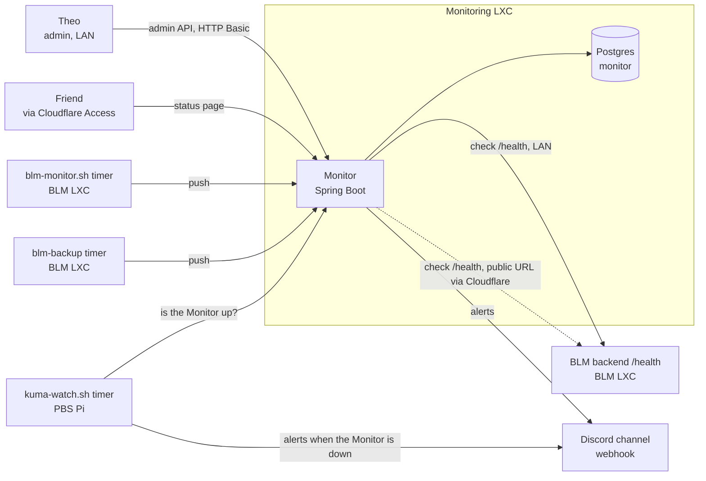
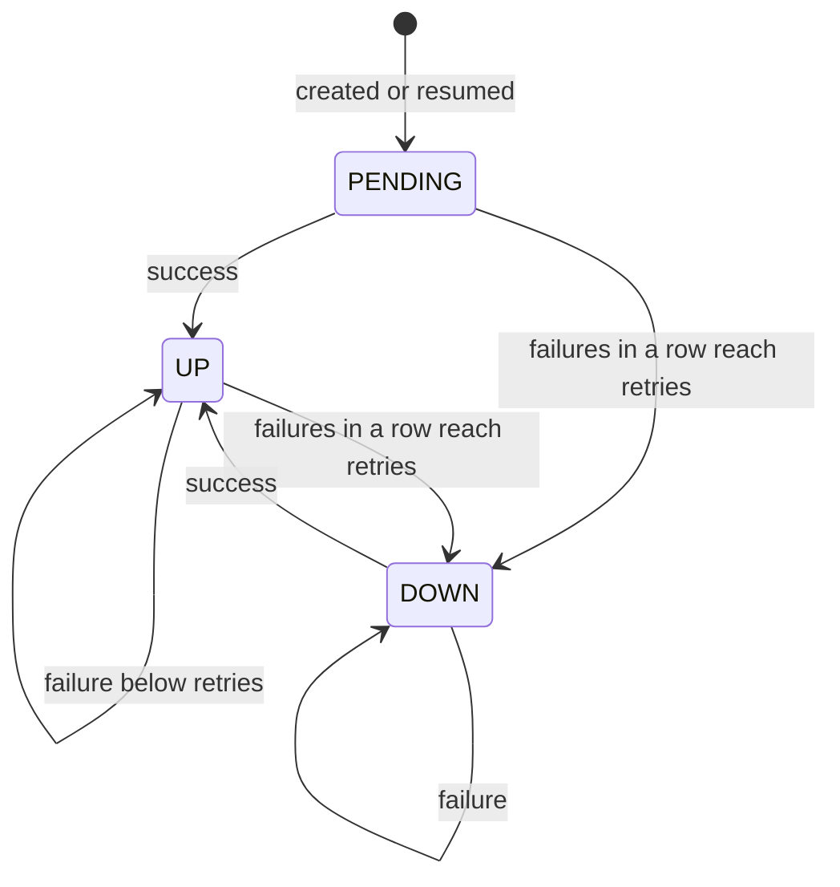
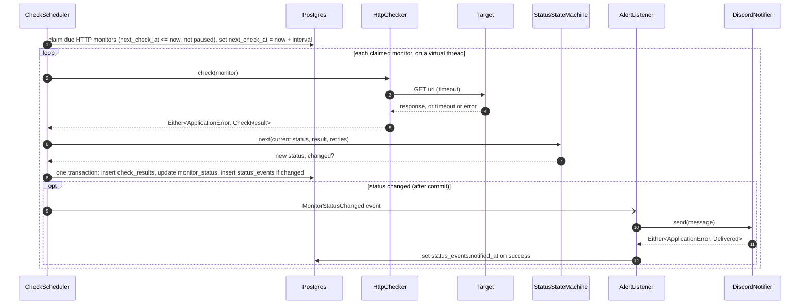
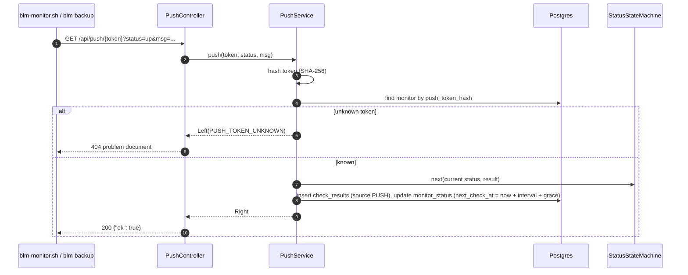
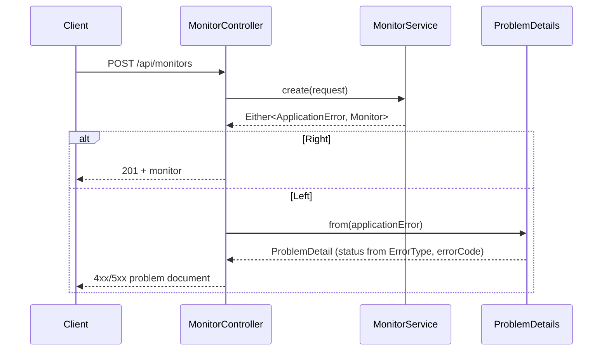
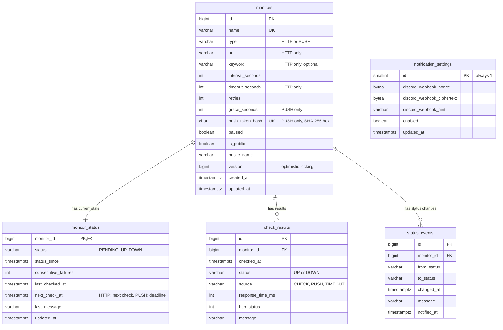
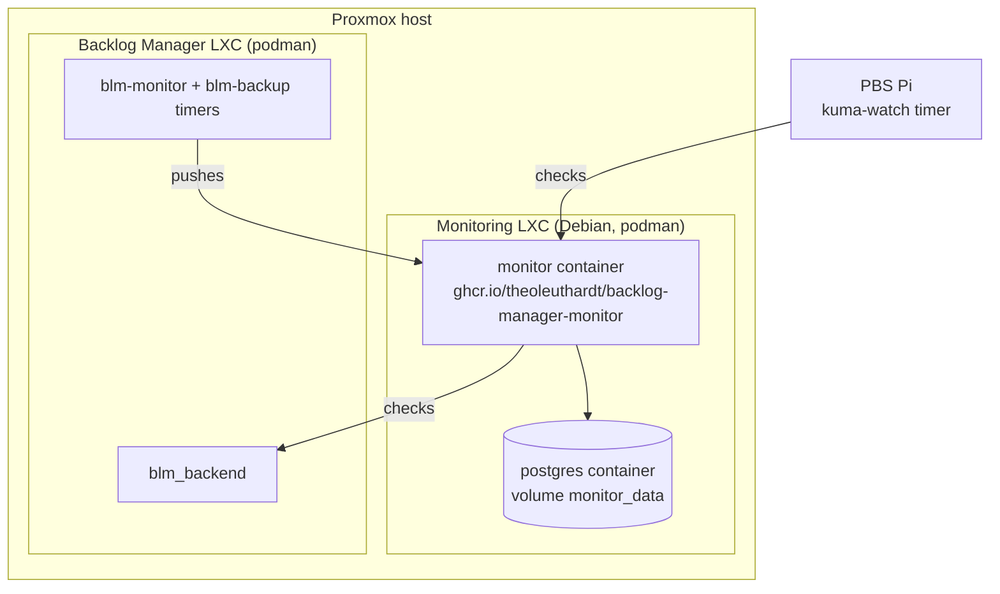

# Monitor: architecture and data model

The design the Monitor service (epic #468) is built from. It describes the
target state; each issue implements its part of it. Where an issue leaves a
decision to the developer, this document gives a **recommendation** (marked
as such) that may be changed in that issue's PR. When the implementation
deliberately deviates, update this document in the same PR.

Stack: Spring Boot 4.1.2, Java 25, Maven, PostgreSQL, Liquibase, OpenAPI
(contract-first), vavr 1.0.1, JUnit, Mockito, Testcontainers.

## 1. Context

The Monitor watches the Backlog Manager (and later anything else in the
homelab), alerts through a Discord webhook and shows a public status page.
It runs in its own LXC, never in the one it watches.



## 2. Packages

Package by feature, not by layer. Every feature has the same internal shape:
a controller that implements the generated API interface, a service with the
logic, Spring Data repositories and the entities.

```text
<base package>
├── MonitorApplication
├── config/         MonitorProperties, SecurityConfig, ClockConfig, RestClientConfig
├── error/          ErrorType, MonitorError, ApplicationError, ProblemDetails (Either -> ProblemDetail),
│                   GlobalExceptionHandler (framework exceptions only)
├── monitor/        MonitorController, MonitorService, Monitor (entity), MonitorRepository, MonitorMapper
├── check/          HttpChecker, CheckResult (entity), CheckResultRepository,
│                   StatusStateMachine (pure), CheckScheduler, RetentionJob,
│                   MonitorStatus (entity), MonitorStatusRepository, StatusEvent (entity), StatusEventRepository
├── push/           PushController, PushService, PushTokens, HeartbeatWatcher
├── notification/   Notifier, DiscordNotifier, NotificationSettings (entity), NotificationSettingsRepository,
│                   NotificationSettingsService, NotificationController, WebhookCipher, AlertListener
└── status/         StatusController (public API), StatusPageController, UptimeCalculator (pure)
```

Generated code (OpenAPI interfaces and models) lives in `target/` under its
own package, for example `<base package>.api`, and is never edited or
committed.

Dependency rules:

- Controllers only call services of their own feature. Services may call
  services of other features, never their repositories.
- `StatusStateMachine`, `UptimeCalculator`, `WebhookCipher` and the error
  catalog are plain Java without Spring, unit tested on their own.
- Everything may depend on `error` and `config`; `error` depends on nothing
  else in the project.
- No cycles between features. Optional later: enforce these rules with
  ArchUnit.

## 3. Error handling

Expected errors are values, not exceptions: services and components return
`Either<ApplicationError, T>` (vavr). Exceptions remain only for programming
errors and for invalid configuration at startup. Code that throws (HTTP
clients, `javax.crypto`) is wrapped in `Try` and turned into an `Either`.

- `ErrorType`: enum, the kind of error, decides the HTTP status
- `MonitorError`: enum, one constant per concrete error, with `errorCode`
  (`Integer`, unique), `message` (`String`) and `errorType` (`ErrorType`)
- `ApplicationError`: class carrying a `MonitorError` (and, if wanted, a
  detail that never contains secrets), the left side of every `Either`

### ErrorType to HTTP status

| ErrorType | HTTP status |
|---|---|
| `VALIDATION` | 400 |
| `UNAUTHORIZED` | 401 |
| `FORBIDDEN` | 403 |
| `NOT_FOUND` | 404 |
| `CONFLICT` | 409 |
| `EXTERNAL_SERVICE` | 502 |
| `INTERNAL` | 500 |

### MonitorError catalog (proposal)

Code ranges: 1xxx monitors, 2xxx checks, 3xxx push, 4xxx notifications,
9xxx general. New errors are added in the issue that needs them.

| Code | Constant | ErrorType | Introduced in |
|---|---|---|---|
| 1001 | `MONITOR_NOT_FOUND` | NOT_FOUND | #479 |
| 1002 | `MONITOR_NAME_TAKEN` | CONFLICT | #479 |
| 1003 | `MONITOR_INVALID_CONFIGURATION` | VALIDATION | #479 |
| 1004 | `MONITOR_ALREADY_PAUSED` | CONFLICT | #490 |
| 1005 | `MONITOR_NOT_PAUSED` | CONFLICT | #490 |
| 2001 | `CHECK_NOT_EXECUTABLE` | INTERNAL | #483 |
| 3001 | `PUSH_TOKEN_UNKNOWN` | NOT_FOUND | #488 |
| 4001 | `NOTIFICATION_FAILED` | EXTERNAL_SERVICE | #491 |
| 4002 | `NOTIFICATION_RATE_LIMITED` | EXTERNAL_SERVICE | #491 |
| 4003 | `NOTIFICATION_NOT_CONFIGURED` | CONFLICT | #504 |
| 4004 | `WEBHOOK_URL_INVALID` | VALIDATION | #504 |
| 4005 | `WEBHOOK_DECRYPTION_FAILED` | INTERNAL | #504 |
| 9000 | `INTERNAL_ERROR` | INTERNAL | #505 |
| 9001 | `VALIDATION_FAILED` | VALIDATION | #505 |
| 9002 | `MALFORMED_REQUEST` | VALIDATION | #480 |
| 9401 | `AUTHENTICATION_REQUIRED` | UNAUTHORIZED | #493 |
| 9403 | `ACCESS_DENIED` | FORBIDDEN | #493 |

A `DOWN` result of a check is **not** an `ApplicationError`: then the watched
service is broken, not the Monitor. `CHECK_NOT_EXECUTABLE` is only for a check
that cannot run at all.

### Error response

Every error, whether it comes from a `Left` or from a framework exception, is
an RFC 9457 problem document with the extra member `errorCode`:

```json
{
  "type": "about:blank",
  "title": "Conflict",
  "status": 409,
  "detail": "A monitor with this name already exists",
  "errorCode": 1002
}
```

`detail` is the `message` of the `MonitorError`. Stack traces, SQL, URLs,
tokens and webhook URLs never appear in a response.

## 4. Status state machine

The state is runtime data (table `monitor_status`); pausing is configuration
(`monitors.paused`). A paused monitor is not checked and keeps no deadline;
resuming sets it back to `PENDING`.



- `retries` (per monitor, at least 1) is the number of failed results in a
  row that turn a monitor `DOWN`; one success turns it `UP` at once and resets
  the counter (`consecutive_failures`).
- A status change is reported as an event. Alerts are sent for `UP -> DOWN`,
  `PENDING -> DOWN` and `DOWN -> UP`; `PENDING -> UP` stays silent, so a
  restart of the Monitor does not flood the channel.

## 5. Flows

### Scheduled HTTP check



The HTTP call runs **outside** any transaction: holding a database connection
while waiting up to the timeout for a remote server would exhaust the pool.

### Push



### Missing push

`HeartbeatWatcher` runs on the same tick as the scheduler. For every push
monitor that is not paused and whose `monitor_status.next_check_at` (the
deadline) has passed, it records a `DOWN` result with source `TIMEOUT` and the
message "no push since ...", then sets the next deadline one interval later.
`next_check_at` therefore means "when to check" for HTTP monitors and "push
expected by" for push monitors, so both use the same index.

### Error handling at the edge



Framework exceptions (malformed JSON, bean validation of the generated DTOs,
Spring Security) are turned into the same format by `GlobalExceptionHandler`
and the security entry points, each with a `MonitorError`.

## 6. Data model

All timestamps are `timestamptz` (Java `Instant`). Enums are stored as
`varchar` with a `CHECK` constraint and mapped by name
(`@Enumerated(EnumType.STRING)` with JPA). Primary keys are `bigint`
identity columns. Liquibase is the only thing that changes the schema;
Hibernate only validates it (`spring.jpa.hibernate.ddl-auto=validate`).



### `monitors`

Configuration of a monitor. Changed only through the admin API.

| Column | Type | Null | Default | Notes |
|---|---|---|---|---|
| `id` | `bigint` identity | no | | primary key |
| `name` | `varchar(100)` | no | | unique, internal name |
| `type` | `varchar(10)` | no | | `HTTP` or `PUSH` (later `TCP`, #502) |
| `url` | `varchar(2000)` | yes | | HTTP only, `http(s)://` |
| `keyword` | `varchar(200)` | yes | | HTTP only, must appear in the body |
| `interval_seconds` | `integer` | no | `60` | check interval or expected push interval, 10 to 604800 |
| `timeout_seconds` | `integer` | no | `10` | HTTP only in practice, 1 to 60 |
| `retries` | `integer` | no | `2` | failures in a row until `DOWN`, 1 to 10 |
| `grace_seconds` | `integer` | no | `60` | PUSH tolerance on top of the interval, 0 to 86400 |
| `push_token_hash` | `char(64)` | yes | | PUSH only, unique, SHA-256 of the token in hex |
| `paused` | `boolean` | no | `false` | |
| `is_public` | `boolean` | no | `false` | shown on the status page |
| `public_name` | `varchar(100)` | yes | | name on the status page |
| `version` | `bigint` | no | `0` | optimistic locking (`@Version`) |
| `created_at` | `timestamptz` | no | `now()` | |
| `updated_at` | `timestamptz` | no | `now()` | |

Constraints:

- `CHECK (type IN ('HTTP', 'PUSH'))`
- `CHECK (type <> 'HTTP' OR url IS NOT NULL)`, `CHECK (type <> 'PUSH' OR (url IS NULL AND keyword IS NULL AND push_token_hash IS NOT NULL))`
- `CHECK (NOT is_public OR public_name IS NOT NULL)`
- range checks on `interval_seconds`, `timeout_seconds`, `retries`, `grace_seconds`

### `monitor_status`

The runtime state, one row per monitor, created together with the monitor.
It is a table of its own so that the scheduler (which writes the state every
few seconds) and the admin API (which writes the configuration) never
overwrite each other's changes, and so that `version` on `monitors` only
counts configuration changes.

| Column | Type | Null | Default | Notes |
|---|---|---|---|---|
| `monitor_id` | `bigint` | no | | primary key, FK `monitors(id) ON DELETE CASCADE` |
| `status` | `varchar(10)` | no | `'PENDING'` | `CHECK (status IN ('PENDING', 'UP', 'DOWN'))` |
| `status_since` | `timestamptz` | no | `now()` | |
| `consecutive_failures` | `integer` | no | `0` | `CHECK >= 0` |
| `last_checked_at` | `timestamptz` | yes | | last result of any source |
| `next_check_at` | `timestamptz` | yes | | HTTP: next check, PUSH: push deadline; `NULL` while paused |
| `last_message` | `varchar(500)` | yes | | |
| `updated_at` | `timestamptz` | no | `now()` | |

Index: `(next_check_at)`, used by the scheduler and the heartbeat watcher.

### `check_results`

Every single result. Grows fast: about 1,440 rows per day for a monitor
checked every minute, so it has a retention job (#487, default 30 days).

| Column | Type | Null | Default | Notes |
|---|---|---|---|---|
| `id` | `bigint` identity | no | | primary key |
| `monitor_id` | `bigint` | no | | FK `monitors(id) ON DELETE CASCADE` |
| `checked_at` | `timestamptz` | no | | |
| `status` | `varchar(4)` | no | | `CHECK (status IN ('UP', 'DOWN'))` |
| `source` | `varchar(10)` | no | | `CHECK (source IN ('CHECK', 'PUSH', 'TIMEOUT'))` |
| `response_time_ms` | `integer` | yes | | HTTP checks only, `CHECK >= 0` |
| `http_status` | `integer` | yes | | HTTP checks only |
| `message` | `varchar(500)` | yes | | push `msg` or error description, cut to length |

Indexes: `(monitor_id, checked_at DESC)` for "the last results of a
monitor" and uptime, `(checked_at)` for the retention delete.

### `status_events`

The history of status changes. Few rows, kept forever. It gives the length
of an outage for the recovery message ("down for 12 min"), lets uptime be
computed from intervals instead of single results, and `notified_at` shows
which alerts were delivered.

| Column | Type | Null | Default | Notes |
|---|---|---|---|---|
| `id` | `bigint` identity | no | | primary key |
| `monitor_id` | `bigint` | no | | FK `monitors(id) ON DELETE CASCADE` |
| `from_status` | `varchar(10)` | no | | |
| `to_status` | `varchar(10)` | no | | |
| `changed_at` | `timestamptz` | no | | |
| `message` | `varchar(500)` | yes | | reason of the change |
| `notified_at` | `timestamptz` | yes | | set once the alert was delivered |

Index: `(monitor_id, changed_at DESC)`.

### `notification_settings`

Exactly one row (`id = 1`, `CHECK (id = 1)`), created by its changeset.

| Column | Type | Null | Default | Notes |
|---|---|---|---|---|
| `id` | `smallint` | no | `1` | primary key, `CHECK (id = 1)` |
| `discord_webhook_nonce` | `bytea` | yes | | 12 random bytes, new for every encryption |
| `discord_webhook_ciphertext` | `bytea` | yes | | AES-256-GCM ciphertext including the tag |
| `discord_webhook_hint` | `varchar(30)` | yes | | webhook id for display, never the token |
| `enabled` | `boolean` | no | `true` | alerts can be switched off without deleting the webhook |
| `updated_at` | `timestamptz` | no | `now()` | |

`CHECK ((discord_webhook_nonce IS NULL) = (discord_webhook_ciphertext IS NULL))`.
The key comes from `MONITOR_ENCRYPTION_KEY` (32 random bytes, Base64); the
Monitor refuses to start without a valid key. If the key is lost, the
webhook is simply set again.

### Liquibase changesets

One file per change under `src/main/resources/db/changelog/changes/`,
included from `db.changelog-master.yaml`. The schema grows with the issues,
which is exactly how a real project evolves:

| File | Issue | Change |
|---|---|---|
| `001-create-monitors.yaml` | #474 | `monitors` with `id`, `name`, `type`, `url`, `keyword`, `interval_seconds`, `timeout_seconds`, `retries`, `paused`, `version`, `created_at`, `updated_at` |
| `002-create-check-results.yaml` | #482 | `check_results` and its indexes |
| `003-create-monitor-status-and-events.yaml` | #486 | `monitor_status`, `status_events` |
| `004-add-push-monitors.yaml` | #488 | `push_token_hash`, `grace_seconds`, the PUSH constraints |
| `005-add-public-fields.yaml` | #495 | `is_public`, `public_name` |
| `006-create-notification-settings.yaml` | #504 | `notification_settings` with its single row |

A changeset that has run is never edited again; a mistake is fixed by a new
changeset.

## 7. API overview

Contract-first: every endpoint is written into the OpenAPI spec (#476) before
it is implemented.

| Method and path | Access | Issue |
|---|---|---|
| `GET /api/monitors` | admin | #480 |
| `POST /api/monitors` | admin | #480 |
| `GET /api/monitors/{id}` | admin | #480, state from #486 |
| `PUT /api/monitors/{id}` | admin | #480 (**recommendation**: PUT with the full configuration; PATCH is decided in #476) |
| `DELETE /api/monitors/{id}` | admin | #480 |
| `GET /api/monitors/{id}/results?limit=` | admin | #486 |
| `POST /api/monitors/{id}/pause`, `POST /api/monitors/{id}/resume` | admin | #490 |
| `POST /api/monitors/{id}/push-token` | admin | #488, creates a new token and returns it once |
| `GET`, `PUT`, `DELETE /api/notifications/discord` | admin | #504 |
| `POST /api/notifications/discord/test` | admin | #504 |
| `GET /api/push/{token}?status=up\|down&msg=&ping=` | public, token | #488 (same format as Uptime Kuma) |
| `GET /api/status` | public | #495 |
| `GET /status` | public | #496 |
| `GET /actuator/health` | public | #469 |

**Recommendation for push tokens (#488):** 32 random bytes from
`SecureRandom`, Base64url. Only the SHA-256 hash is stored, the token is
shown once when it is created (like a GitHub token). A lost token is
replaced through `POST /api/monitors/{id}/push-token`.

## 8. Configuration

All settings live under the prefix `monitor` in a validated
`@ConfigurationProperties` record (#473); secrets come only from environment
variables.

| Setting | Environment variable | Default |
|---|---|---|
| database URL, user, password | `SPRING_DATASOURCE_URL`, `SPRING_DATASOURCE_USERNAME`, `SPRING_DATASOURCE_PASSWORD` | |
| active profile | `SPRING_PROFILES_ACTIVE` | `dev` locally, `prod` in the container |
| admin user | `MONITOR_ADMIN_USERNAME` | |
| admin password (BCrypt hash) | `MONITOR_ADMIN_PASSWORD_HASH` | |
| webhook encryption key | `MONITOR_ENCRYPTION_KEY` | none, start fails without it |
| scheduler tick | `MONITOR_SCHEDULER_TICK` | `5s` |
| default HTTP timeout | `MONITOR_HTTP_DEFAULT_TIMEOUT` | `10s` |
| result retention | `MONITOR_RETENTION_DAYS` | `30` |
| max length of a push message | `MONITOR_PUSH_MESSAGE_MAX_LENGTH` | `200` |

## 9. Concurrency and transactions

- One scheduler thread runs the tick. It **claims** due monitors by moving
  their `next_check_at` forward before the checks start, so a slow check is
  never started twice for the same monitor.
- Checks run in parallel on virtual threads (`spring.threads.virtual.enabled=true`).
- The HTTP call is outside any transaction; storing the result, the new
  status and a status event is one short transaction.
- Alerts are sent only after that transaction committed
  (`@TransactionalEventListener(phase = AFTER_COMMIT)`), so no alert goes out
  for a change that was rolled back.
- Time always comes from an injected `java.time.Clock`; tests use a fixed or
  manually advanced clock.

## 10. Testing

| Level | What | Tools |
|---|---|---|
| Unit | state machine, uptime calculation, error catalog, cipher, URL validation | JUnit, `@ParameterizedTest` |
| Service | services with mocked repositories and collaborators | JUnit, Mockito |
| Web slice | controllers, error responses, security rules | `@WebMvcTest`, MockMvc, `@MockitoBean` |
| Persistence slice | repositories against the real schema | `@DataJpaTest`, Testcontainers |
| Integration | whole flows: a fake service goes down, the Monitor alerts | `@SpringBootTest`, Testcontainers, WireMock |

Tests come first (TDD), and every `Left` in a test is checked for its exact
`MonitorError`.

## 11. Deployment



Image built and published by CI (#497, #498), deployed with podman-compose
(#499), checks wired up in #500.

## 12. Decisions

| Decision | Reason |
|---|---|
| Separate service, separate LXC | A monitor must keep working when what it watches fails. |
| Package by feature | A feature's code stays together; dependencies between features are visible. |
| Contract-first OpenAPI | The API is designed before it is coded; DTOs are generated, not written. |
| vavr `Either<ApplicationError, T>` | Expected errors are part of the signature and cannot be forgotten. |
| Own Postgres database, Liquibase | Independent of the Backlog Manager schema and Alembic. |
| **Recommendation:** Spring Data JPA (#478) | Most likely what is used at work; Spring Data JDBC is the simpler alternative. |
| State in `monitor_status`, history in `status_events` | Scheduler and admin API do not overwrite each other; outages and uptime come from few rows. |
| **Recommendation:** hashed push tokens (#488) | A database leak does not reveal tokens that allow faking pushes. |
| AES-256-GCM for the webhook URL (#504) | Whoever has the URL can post into the channel. |
| Uptime Kuma compatible push URLs | The existing host check and backup scripts work unchanged. |
| Alerts only on status changes, after commit | No flood of messages, no alert for a change that did not happen. |
| **Recommendation:** status page with Thymeleaf (#496) | One deployable, no extra frontend build; a static page with JavaScript is the alternative. |
